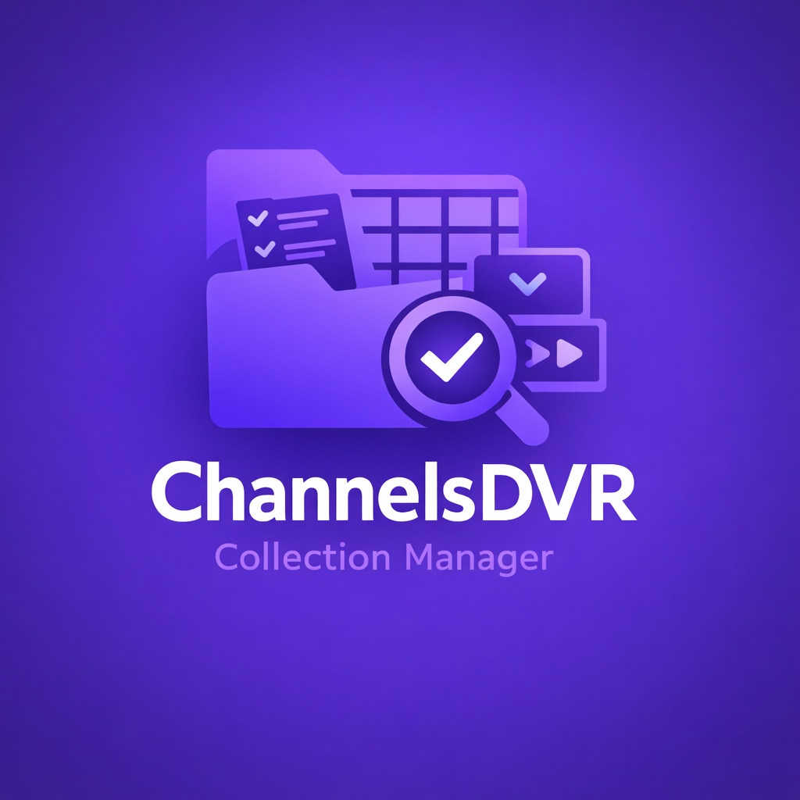

# Channels DVR Collection Manager

A powerful web-based tool for automatically managing channel collections in Channels DVR based on flexible pattern matching rules with Dispatcharr IPTV integration.


[](https://hub.docker.com/r/curtisfeatures/channels-dvr-collection-manager)
[](https://github.com/CurtisFeatures/channels-dvr-collection-manager)
[](https://opensource.org/licenses/MIT)

## 🎯 What's New in v2.2.0

- **Smarter "Events Last" sorting** - channels showing a named event (`Crystal Palace v Chelsea @ Oct 25 11:45 AM :Sky Sports UK 04`) go first; generic placeholders (`:Sky Sports UK 48`, `Event 12`, `PPV 03`, `No Event Scheduled`) go after, each part in channel-number order.
- **Curato Command Center endpoint** - `/api/curato/rule` lets Curato's *New channel group* wizard create the collection, add or update a number-range rule and sync it in one call (see *Curato Command Center endpoint* below).

## 🎯 What's New in v2.0.0

### 🚀 Major Features

**Dispatcharr Integration**
- **📡 Connect to Dispatcharr** - Seamless IPTV management integration
- **🔄 Dispatcharr Sync** - Auto-update channel patterns from Dispatcharr groups
- **⊕ Auto Channel Creation** - Detect and use Dispatcharr's built-in sync
- **📥 One-Click Rules** - Create rules directly from Dispatcharr groups
- **🌍 Provider & Local Groups** - Support for both M3U providers and local channels

**Collection Management**
- **➕ Create Collections** - Build new collections on-the-fly with regex transforms
- **🔀 Merge Rules** - Combine multiple rules targeting the same collection
- **⚠️ Shared Collection Protection** - Additive mode prevents rules from fighting
- **🎨 Collection Regex Builder** - Transform names with common patterns

**Performance & Reliability**
- **🔒 Exact Number Matching** - Pattern "400" won't match "6400" anymore
- **📊 Smart Filtering** - Server-side filtering for instant results
- **🎯 On-Demand Loading** - Fetch channel data only when needed

See [CHANGELOG.md](Documentation/CHANGELOG.md) for complete v2.0 details

## ✨ Features

### Dispatcharr Integration (NEW in v2.0)
- **Dispatcharr Connection** - Connect to your Dispatcharr IPTV server
  - JWT authentication with token refresh
  - Test connection before saving
  - Secure password storage
- **Browse Groups** - View all enabled Dispatcharr channel groups
  - See channel counts and provider info
  - Filter by provider or local groups
  - Auto Sync detection and badges
- **Quick Rule Creation** - One-click rule generation
  - Auto-populates group name and patterns
  - Smart channel number pattern detection
  - Supports ranges (101-104,107-108)
- **Dispatcharr Sync Rules** - Auto-update patterns from Dispatcharr
  - Patterns refresh before each sync
  - Always uses latest channel assignments
  - Perfect for dynamic IPTV lineups
- **Collection Creation** - Create collections on-the-fly
  - Name transform with regex (remove prefixes, suffixes, etc.)
  - Auto-detect existing collections
  - Visual preview of transformed names

### Shared Collection Management (NEW in v2.0)
- **Automatic Detection** - Detects when multiple rules target one collection
- **Additive Mode** - Channels are added, never removed from shared collections
- **Visual Indicators** - ⚠️ Shared (N) badges show shared collections
- **Merge Rules** - Combine multiple rules into one
  - One-click merge with confirmation
  - Combines all patterns
  - Switches to normal mode after merge

### Organization & Management
- **Import/Export Rules** - Backup and share your rule configurations
  - Export all rules or by group
  - Import with merge or replace modes
  - Automatic duplicate detection and warnings
- **Groups/Folders** - Organize rules into collapsible categories
  - Sports, News, Entertainment, IPTV, etc.
  - Autocomplete for existing group names
  - Visual folder icons with expand/collapse
- **Search & Filter** - Find rules quickly
  - Real-time search by name, pattern, or collection
  - Filter by group
  - Combined search + filter support
- **Rule Templates** - Save successful patterns for reuse
  - Build once, use many times
  - Perfect for packaging with releases
  - Include descriptions for documentation

### Advanced Scheduling
- **Time-Based Activation** - Rules run only when scheduled
  - Select specific days of week (Mon-Sun)
  - Set time windows (e.g., 9 AM - 5 PM)
  - Handles overnight ranges (22:00 - 06:00)
  - Visual schedule indicators on rule cards

### Automated Collection Management
- **Pattern-Based Matching** - Use regex patterns to automatically match channels
- **Visual Pattern Builder** - Build patterns without regex knowledge
  - Simple mode with 7 pattern types
  - Advanced mode with multi-condition AND/OR logic  
  - Live preview showing matching channels
  - Smart pattern editing - Edit builder patterns visually
- **Multiple Match Types** - Match on channel name, number, or EPG data
- **Exact Number Matching** - Word boundary matching prevents false positives
- **Source Filtering** - Include or exclude specific sources
- **Smart Sorting** - Multiple options including "Events Last" for sports
- **Per-Rule Sync** - Custom intervals for each rule
- **Selective Refresh** - Refresh only relevant sources before syncing

### User Experience
- **Quick Enable/Disable Toggle** - Beautiful animated switch on each rule
- **Copy & Clone** - Reuse patterns and duplicate rules
- **Live Preview** - Test patterns before saving
- **ESC Key Support** - Close modals quickly
- **Scrollable Results** - View all matches, not just first few
- **Unified Button Alignment** - Consistent card layouts

## 🚀 Quick Start

### Docker Compose (Recommended)

1. Create `docker-compose.yml`:
```yaml
version: '3.8'

services:
  channels-collection-manager:
    image: curtisfeatures/channels-dvr-collection-manager:latest
    container_name: channels-collection-manager
    ports:
      - "5000:5000"
    volumes:
      - ./config:/config
    environment:
      - DVR_URL=http://your-dvr-ip:8089
      # Optional: Connect to Dispatcharr This can be entered within the GUIs application settings
      - DISPATCHARR_URL=http://your-dispatcharr-ip:9191
      - DISPATCHARR_USERNAME=your-username
      - DISPATCHARR_PASSWORD=your-password
    restart: unless-stopped
```

2. Start the container:
```bash
docker-compose up -d
```

3. Access the web UI at `http://localhost:5000`

### Configuration

**Required:**
- `DVR_URL` - Your Channels DVR server URL (e.g., `http://192.168.1.100:8089`)

**Optional (Dispatcharr Integration) - This can be entered within the GUIs application settings:**
- `DISPATCHARR_URL` - Your Dispatcharr server URL (e.g., `http://192.168.1.101:9191`)
- `DISPATCHARR_USERNAME` - Dispatcharr username
- `DISPATCHARR_PASSWORD` - Dispatcharr password

You can also configure Dispatcharr from the web UI Settings page.

## 📖 Documentation

- **[Quick Start Guide](Documentation/QUICKSTART.md)** - Get up and running in 5 minutes
- **[First Rule Guide](Documentation/FIRST_RULE_GUIDE.md)** - Create your first rule step-by-step
- **[Advanced Features](Documentation/ADVANCED_FEATURES.md)** - Pattern builder, scheduling, templates
- **[Changelog v2.0](Documentation/CHANGELOG.md)** - All v2.0 changes
- **[Contributing](Documentation/CONTRIBUTING.md)** - How to contribute

## 🎬 Common Use Cases

### IPTV Provider Management
```yaml
# Use Dispatcharr integration to:
1. Browse all provider channel groups
2. Create rules from groups with one click
3. Auto-update patterns when channels change
4. Manage multiple providers separately
```

### Sports Collections
```yaml
# Pattern: NBA|Lakers|Clippers|Basketball
# Match Type: Name
# Sorting: Events Last (keeps live games at top)
# Schedule: Mon-Sun, 12:00 PM - 11:00 PM (game hours)
```

### News by Network
```yaml
# Pattern: ^(CNN|MSNBC|Fox News)
# Match Type: Name
# Auto-refresh: Yes (updates when EPG refreshes)
```

### Channel Number Ranges
```yaml
# Pattern: 100-199
# Match Type: Number
# Result: Channels 100-199 (exactly, won't match 1001)
```

### Shared Collection Example
```yaml
# Multiple rules → One collection
Rule 1: NBA → Sports Collection
Rule 2: NFL → Sports Collection  
Rule 3: Soccer → Sports Collection

Result: All channels combined (additive mode)
Option: Merge into single rule with all patterns
```

## 🔧 Advanced Usage

### Dispatcharr Workflow

1. **Connect Dispatcharr**
   - Settings → Dispatcharr Configuration
   - Enter URL, username, password
   - Test connection

2. **Browse Groups**
   - Click "📡 Dispatcharr" tab
   - View all enabled groups
   - Filter by provider or local

3. **Create Rule**
   - Click "➕ Create Rule" on any group
   - Review auto-generated pattern
   - Select or create collection
   - Enable Dispatcharr Sync for auto-updates

4. **Manage Collections**
   - Create new collections with regex transforms
   - Example: "UK| DOCUMENTARY ᴴᴰ" → "DOCUMENTARY"
   - System checks if collection exists

### Curato Command Center endpoint

Curato Command Center's *New channel group* wizard sets up a rule in one call:

- `POST /api/curato/rule` with `{key, name, collection_name, ranges: ["1000-1049"], source_ids: ["M3U-Name"], sort_order, sync_interval_minutes, group, sync}` makes the collection if needed, adds or updates the rule (found again by `key`), then syncs it if `sync` is true.
- `GET /api/curato/rule?key=...` returns the rule and how many channels its collection has.
- `DELETE /api/curato/rule?key=...[&delete_collection=1]` removes the rule. The collection is only deleted when this endpoint made it and no other rule uses it.

### "Events Last" sort order

Channels with a named event go first, generic placeholder channels go after, each part in channel-number order.
A channel counts as generic when its name has no description before the channel label (`:Sky Sports UK 48`),
is only words and a number (`Event 12`, `PPV 03`, `DAZN UK - 50`, `Paramount+ 50 :`), or says there's nothing on
(`No Event Scheduled`, `Off Air`, `TBA`). Anything with an `@`, `v`/`vs`, a time or a date is named
(`Crystal Palace v Chelsea @ Oct 25 11:45 AM :Sky Sports UK 04`).

### Rule Merging

When you have multiple rules targeting the same collection:

1. System automatically uses **Additive Mode**
   - Channels are added
   - Channels are never removed
   - Prevents rules from fighting

2. Click **🔀 Merge Rules** to combine them
   - Combines all patterns into one rule
   - Deletes duplicate rules
   - Returns to normal mode

## 🐛 Troubleshooting

### Dispatcharr Connection Issues
- Verify URL includes `http://` and port (`:9191`)
- Check username and password are correct
- Ensure Dispatcharr is running and accessible
- Check Docker network if using containers

### Collections Not Updating
- Check rule is enabled (toggle switch)
- Verify collection exists in Channels DVR
- Check sync logs for errors
- For shared collections, check additive mode is active

### Pattern Not Matching
- Use Preview to test patterns
- For numbers, ensure exact match (400 won't match 6400)
- Check match type (Name vs Number)
- Verify regex syntax is correct

## 📦 Data Storage

All configuration is stored in `/config`:
- `rules.json` - Your rule definitions
- `dispatcharr.json` - Dispatcharr connection settings (tokens cached)

## 🤝 Contributing

<!-- Contributions are welcome! See [CONTRIBUTING.md](Documentation/CONTRIBUTING.md) for guidelines. -->

## 📄 License

MIT License - see [LICENSE](Documentation/LICENSE) for details.

## 🙏 Acknowledgments

- Built for [Channels DVR](https://getchannels.com/)
- Integrates with [Dispatcharr](https://github.com/Dispatcharr/Dispatcharr) IPTV management
- Community feedback and feature requests

## 📞 Support

- 🐛 [Report Issues](https://github.com/CurtisFeatures/channels-dvr-collection-manager/issues)
- 💬 [Discussions](https://github.com/CurtisFeatures/channels-dvr-collection-manager/discussions)


---

**Made with ❤️ for the Channels DVR community**
